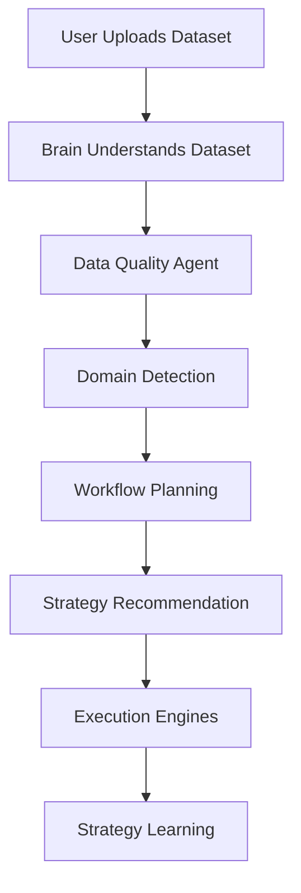

# 🔄 Agentix Workflow

The standard operational flow of a dataset moving through the Agentix ecosystem.

## 1. User Uploads Dataset
The user uploads a CSV, JSON, or SQL dump via the Next.js Dashboard.

## 2. Brain Understands Dataset
The Brain receives the metadata (not raw rows) and identifies user intent and business context.

## 3. Data Quality Agent
The system assesses missing values, outliers, and schema drift.

## 4. Domain Detection
The system identifies the business domain (e.g., Retail, Finance) to tailor prompt engineering.

## 5. Workflow Planning
The Brain deliberates on various hypotheses (e.g., Impute missing values with mean vs. drop rows).

## 6. Recommendation
Procedural Memory evaluates the plan. If a highly successful Strategy already exists, it recommends REUSING it.

## 7. Execution
Deterministic Python engines execute the exact workflow steps. No code hallucinations.

## 8. Learning
The outcome is scored (time taken, memory used, success rate) and stored as an Episode. The Strategy Engine learns from the execution.
